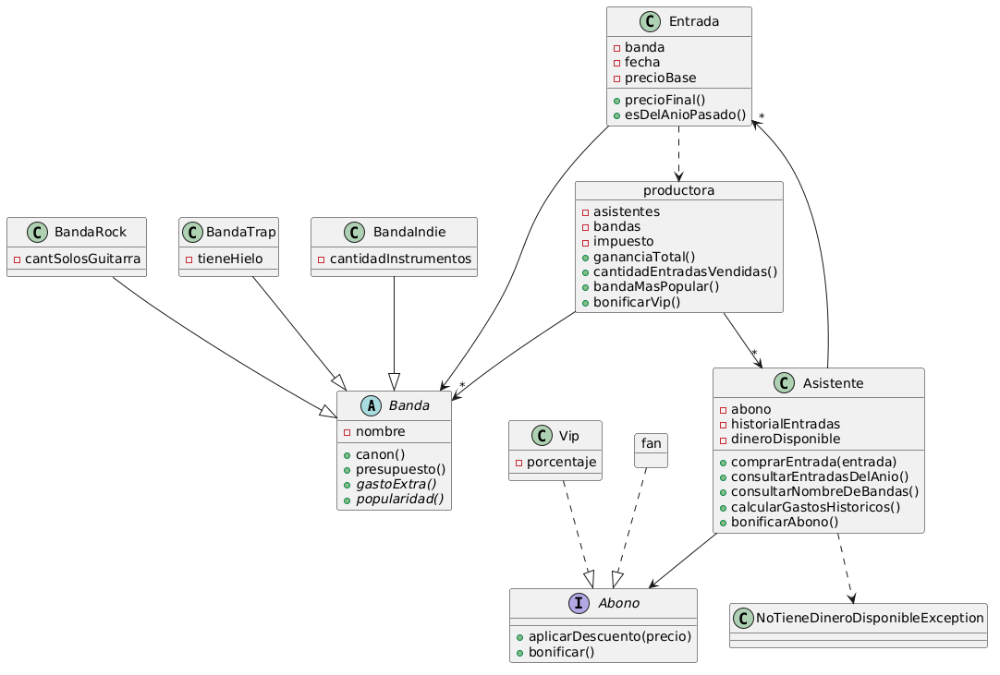

# Trabajo práctico individual de objetos - PDEP Entertainment

## Diagrama de clases

## Teoría
5 conceptos teóricos aplicados en este trabajo pueden ser los siguientes:

- Herencia
    En la parte de los distintos tipos de bandas decidí crear una clase padre Banda y 3 clases hijas que extiendan de ella (cada tipo de banda). La clase padre generaliza, por ejemplo, el valor base del canon y la lógica para calcular el presupuesto, mientras que las clases hijas sobreescriben gastoExtra() y popularidad(). 

- Composición
    Para los abonos elegí usar composición para delegar el comportamiento de los descuentos y las bonificaciones en cada tipo de abono. Además, aunque no se especifique textualmente en el enunciado, asumí por lógica que un asistente podría eventualmente cambiar de fan a vip o viceversa, y para estos casos la composición es mucho más útil que la herencia.

- Polimorfismo
    Además de herencia, para las bandas utilicé polimorfismo ya que todos los tipos de bandas tenían que calcular su popularidad() y gastoExtra(), pero cada tipo de banda lo hacía de una manera distinta.

- Manejo de errores (excepciones + try/catch)
    En la clase Asistente elegí implementar la estructura try/catch para poder manejar las situaciones en las que un asistente intenta comprar una entrada sin dinero disponible. De esta forma, se notifica el error al querer hacer una operación inválida, pero continua normalmente la ejecución del programa.

- Encapsulamiento
    Este punto no está en alguna clase en particular sino a lo largo del proyecto. Intenté respetar las responsabilidades de cada objeto manipulando sus atributos o revisándolos solo internamente. Si un objeto, como por ejemplo productora, quiere bonificar a los abonados vips, productora no podrá modificar directamente los abonos sino que le enviará un mensaje al Asistente y este último se lo comunica a Vip, quien finalmente altera su porcentaje.